# 03. Руководство администратора

**Роль:** `admin` (полный рабочий доступ) или `superadmin` (то же + управление
пользователями и ролями). Администратору доступны **все** разделы панели.

> Скриншоты в этом руководстве сняты с реальной панели (демо-данные).
> Ваш экран может отличаться составом данных, но не устройством разделов.

---

## Вход в панель

Адрес: `http://10.0.119.100/`. Логин и пароль выдаёт супер-админ; при первом
входе со стандартным паролем панель **принудительно попросит сменить пароль**.

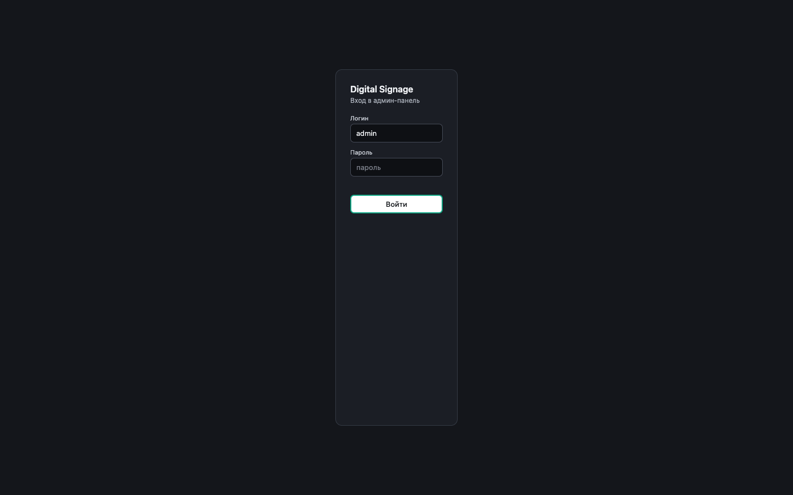

Разделы слева: Дашборд · Эфир сети · Бегущая строка · Экраны · Медиатека ·
Плейлисты · Расписание · Кампании · Модерация · Отчёты · Биллинг ·
Обновление агентов · Настройки.

---

## Дашборд

Общее состояние сети в реальном времени (обновляется по WebSocket, без
перезагрузки страницы).

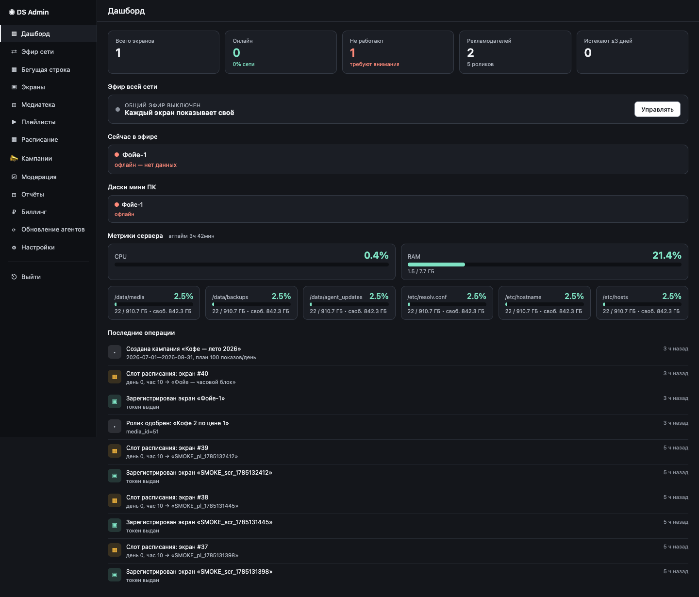

- **Плитки KPI**: всего экранов · онлайн · не работают · рекламодателей ·
  роликов, у которых срок действия истекает в ближайшие ≤3 дней (они тихо
  пропадут из эфира — успейте продлить или заменить).
- **Эфир всей сети**: включён ли общий эфир; кнопка «Управлять» ведёт в раздел
  «Эфир сети».
- **Что играет сейчас** на каждом экране; **диски мини-ПК** (свободное место).
- **Метрики сервера**: CPU, RAM, диски, аптайм.
- **Последние операции** — лента журнала действий (аудита).
- Ниже — **нерабочие ролики** (файлы, на которых плеер спотыкается) и
  истекающие ролики.

---

## Экраны

Учёт мини-ПК, их группы и команды управления.

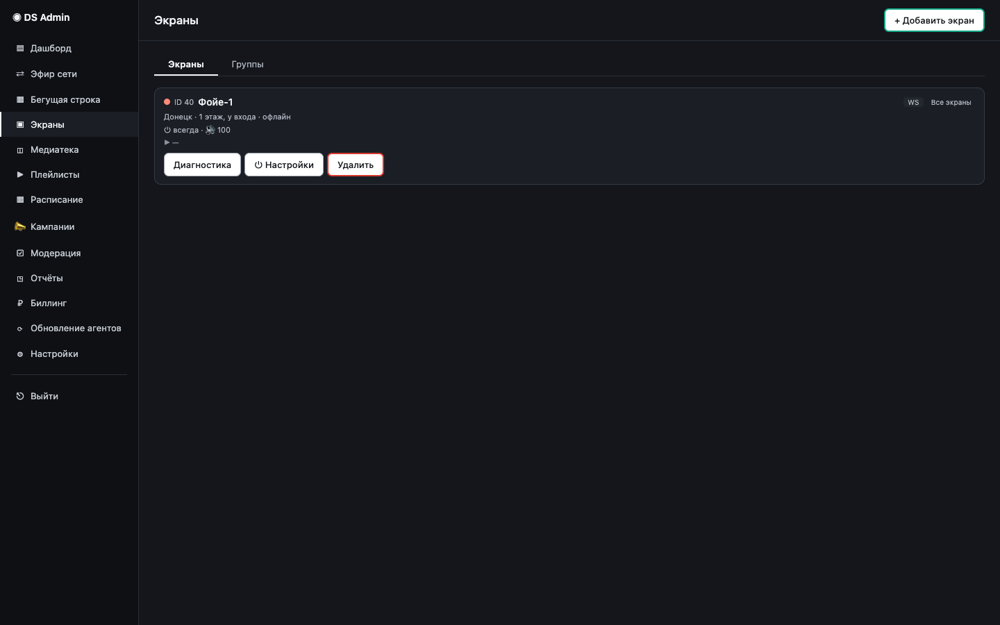

- **+ Добавить экран** → имя/город/размещение → «Создать и получить токен».
  Скопируйте **токен** и запомните **ID** — они нужны при установке агента
  (см. [02_УСТАНОВКА_АГЕНТ](02_УСТАНОВКА_АГЕНТ.md)).
- **Тип площадки** у каждого экрана: *Прочее / Магазин / Магазин с
  алколицензией / Торговый центр / Офис*. Управляет допуском рекламы по 38-ФЗ
  (алкоголь — только «Магазин с алколицензией», ст. 21).
- **Группы экранов** («+ Создать группу», добавить/убрать экран): на группу
  удобно назначать общее расписание. Новый экран без группы автоматически
  попадает в служебную группу «Все экраны».
- **Команды экрану** (доставляются мгновенно по WebSocket; индикатор показывает,
  активен ли push или агент работает по опросу):
  - **■ Стоп** — остановить показ; **▶ Показ** — возобновить по расписанию
    (без перезапуска агента);
  - **▶ Запустить** / **▶ Синхростарт** — запуск показа, в т.ч. синхронный на
    нескольких экранах;
  - **↺ Агент** — перезапустить службу `ds-agent` на мини-ПК.
- **Телеметрия на карточке** (heartbeat ~30 с): свободный диск, версии
  ОС/плеера, разница часов, «что играет».
- **🧾 Диагностика** — по кнопке агент собирает архив логов (journalctl,
  ds-agent.log, конфиг без токена, версии, диск, состояние плеера и часов)
  и присылает на сервер (~15–30 с); список архивов появляется под строкой
  экрана, каждый можно скачать. Хранятся последние 5 архивов на экран.
  Если экран офлайн — команда выполнится, когда он выйдет на связь
  (резерв: скрипт на самом мини-ПК `bash /opt/ds-agent/collect_diag_agent.sh`).
- **⏻ Настройки** (кнопка на строке экрана) — питание монитора по расписанию
  (время вкл/выкл МСК, пусто = всегда включён) и громкость день/ночь
  (0–100, с границами ночи). Текущий режим виден бейджем на строке
  (`⏻ всегда` или `⏻ 08:00–22:00`).
- **Часы**: панель показывает разницу между часами сервера и мини-ПК — если
  она растёт, проверьте NTP (см. runbook).
- **📺 Монитор** — бейдж подключения монитора к видеовыходу мини-ПК:
  зелёный — монитор виден, **красный — кабель HDMI/DisplayPort отсоединён
  или монитор обесточен** (мини-ПК при этом «онлайн и играет», но зрителю
  ничего не видно), серый — состояние неизвестно (агент старее 1.2.0 либо
  драйвер не сообщает статус). У красного бейджа под карточкой появляется
  строка «⚠ Монитор отключён от видеовыхода» со временем, когда это
  случилось; такие экраны также собраны на Дашборде в блоке «Монитор не
  подключён» и, если включено, уходят уведомлением в MAX.
  Наведите курсор на бейдж — во всплывающей подсказке видны все выходы
  (например `HDMI-A-1:connected, DP-1:disconnected`).
  Метод определяет **наличие кабеля/EDID**, а не «картинку»: монитор,
  выключенный кнопкой, часто продолжает отвечать и остаётся зелёным.

---

## Медиатека

Хранилище всех роликов. Структура: **Общая медиатека** (без привязки к
рекламодателю) · **Заглушки** (служебные заставки) · **рекламодатели → папки →
файлы**.

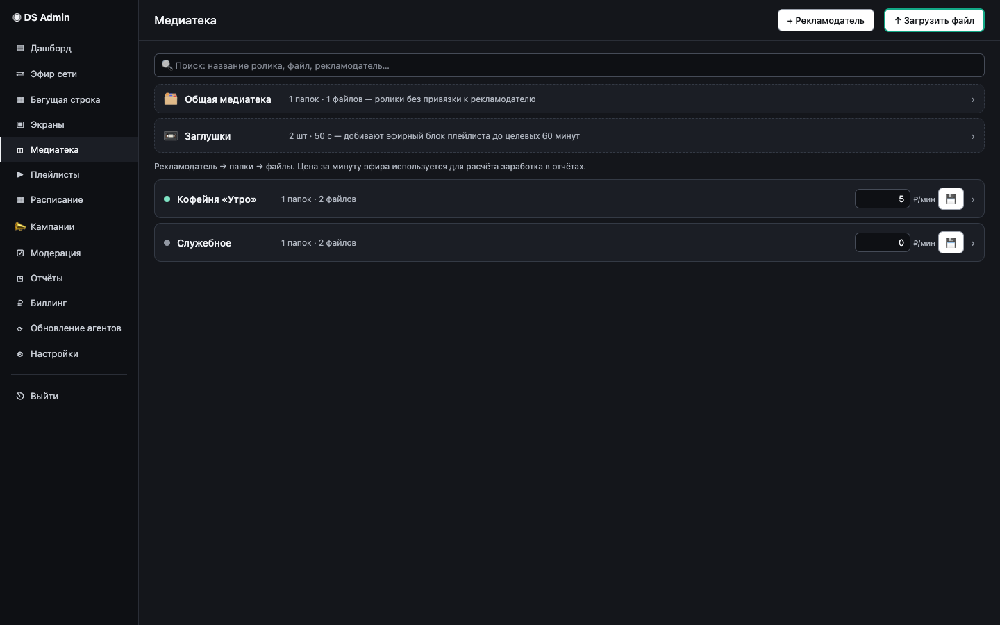

- У рекламодателя задаётся **цена за минуту эфира** (₽/мин) — по ней отчёты
  считают заработок, а биллинг — счета.
- **Поиск** сверху ищет по названию ролика, файлу и рекламодателю.
- На карточке файла: миниатюра (**клик — просмотр ролика**, см. ниже), статус
  модерации («на модерации»/«отклонён»), метка «в эфире» (используется в
  плейлисте), метка **«дубль»** (тот же файл уже есть в медиатеке под другим
  названием), возрастная маркировка, скачать, выбрать несколько и **удалить
  выбранные**, пометить/снять пометку заглушки, длительность показа для
  баннеров-картинок (⏱).

### Просмотр ролика
Клик по миниатюре открывает окно-плеер: видео с обычными элементами управления
(пауза, перемотка, громкость, полный экран) или картинку-баннер. Справа —
сведения: длительность, размер кадра, имя и размер файла, папка или
рекламодатель, статус модерации (для отклонённого — причина), **в скольких
плейлистах стоит**. Закрывается кнопкой ✕, кликом по затемнённому фону или
клавишей **Esc**. Тот же просмотр открывается кнопкой **«▶ смотреть»** на плитке
ролика в окне сборки плейлиста. Документы (папка «Документы») не
воспроизводятся — их можно только скачать.

### Загрузка файла

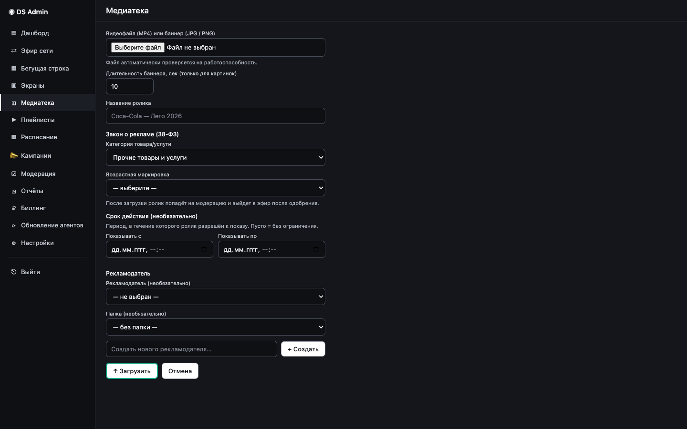

Файл (MP4 или баннер JPG/PNG) + название. Обязательна **декларация категории по
38-ФЗ**; в зависимости от категории появляются поля: возрастная маркировка,
текст обязательного предупреждения (дисклеймер), номер лицензии (финансы).
- *Служебный контент* — не реклама, в эфир без модерации.
- Запрещённые категории (табак) — загрузка **отклоняется**.
- Остальная реклама уходит **на модерацию** и выходит в эфир только после
  одобрения.
Дополнительно: срок показа «с/по», рекламодатель и папка (или без них — файл
попадёт в Общую медиатеку), длительность показа для картинок. Каждый файл
автоматически проверяется на работоспособность; одновременная загрузка
одинаковых имён безопасна.

**Проверка дублей.** Дубль — это *точно тот же файл* (совпадает контрольная
сумма MD5), даже если у него другое имя. Если такой файл уже есть, панель
покажет окно **«Такой ролик уже есть в медиатеке»**: миниатюра и сведения о
существующем ролике (название, папка, дата загрузки, длительность, в скольких
плейлистах стоит) и три кнопки:
- **«Отмена»** — ничего не загружается, лишней копии не остаётся ни в базе, ни
  на диске (так же работают ✕, Esc и клик по фону);
- **«Всё равно загрузить»** — копия загружается (пока она догружается, окно не
  закрывается);
- **«Открыть существующий»** — откроется просмотр уже имеющегося ролика.
Пересжатые или обрезанные версии дублем не считаются — ловятся только точные
копии. Файлы папки «Документы» в проверке не участвуют. Уже загруженные копии
помечены на карточках меткой «дубль» — по ней удобно найти и удалить лишнее.

### Общая медиатека и свои папки

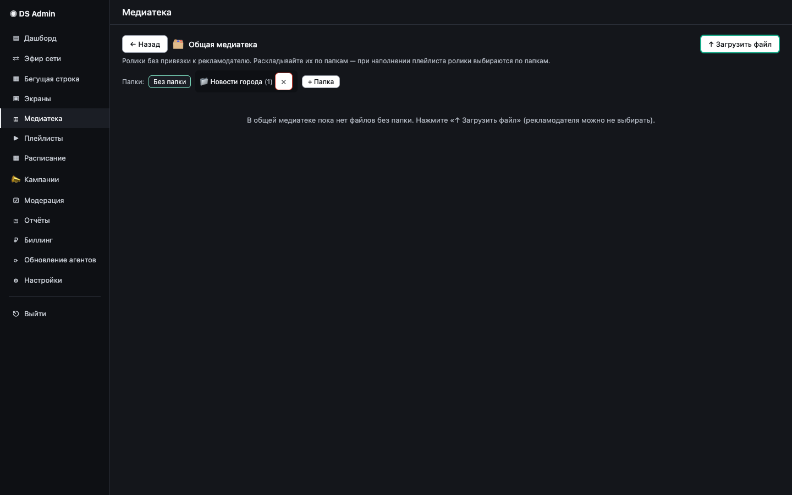

Ролики без привязки к рекламодателю. Создавайте **свои папки** («+ Папка»),
загружайте файлы сразу в папку и перекладывайте их селектом на карточке.
При наполнении плейлиста ролики выбираются **по папкам**.

### Заглушки

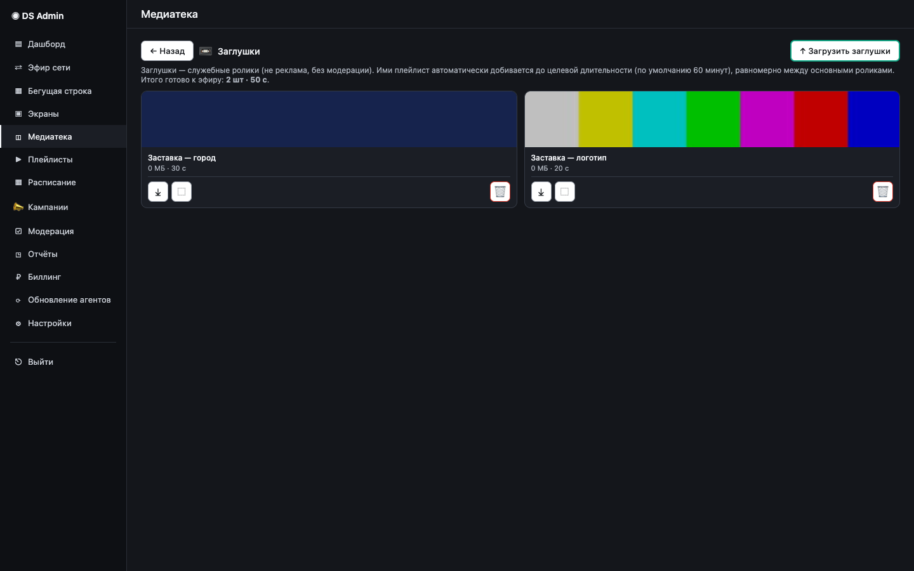

Служебные ролики-заставки (не реклама, без модерации), которыми плейлист
автоматически добивается до целевой длительности. Загрузка — сразу пачкой
(«Загрузить заглушки»), показаны длительности и итог «готово к эфиру».

- Заглушки тоже **просматриваются** (клик по миниатюре) и **проверяются на
  дубли**: если файл из пачки уже есть, окно «Такой ролик уже есть» появляется
  по очереди для каждого такого файла, остальные грузятся как обычно; в итоге
  панель пишет «Загружено заглушек: X из M, пропущено (уже есть): K».
- В окне «Новый плейлист» заглушки **не показываются** — они подмешиваются в
  эфирный блок сами.
- Готовые заглушки (с учётом типа площадки) скачиваются на **все экраны
  заранее**, а не в момент, когда понадобятся, — новая заглушка доходит до
  мини-ПК при ближайшей синхронизации файлов.

---

## Плейлисты

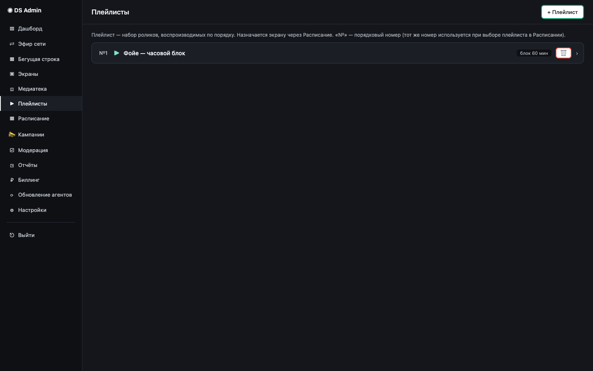

Плейлист — набор роликов по порядку. Его можно **сразу отправить на экраны** на
нужные даты и часы (шаг «Куда и когда») или назначить через Расписание. «№» в
списке — тот же номер, что при выборе плейлиста в Расписании. Бейдж показывает
режим: **«блок N мин»** или **«произвольный»**. Клик по плейлисту открывает его
карточку.

### Новый плейлист: окно сборки
Кнопка **«+ Плейлист»** открывает окно «Новый плейлист» (вместо системного
запроса названия):

1. **Название** (обязательно).
2. **Ролики.** Слева — папки (Все ролики · Общая медиатека · общие папки ·
   рекламодатели и их папки; показаны только те, где есть подходящие ролики).
   Над плитками — **поиск по названию сразу по всем папкам** (регистр и «ё/е» не
   важны, совпадение подсвечивается, рядом «найдено N»). На плитке: превью,
   название, длительность и кнопка **«▶ смотреть»** (просмотр ролика, см.
   «Медиатека»).
3. **Клик по плитке** ставит галочку; цифра в галочке — порядок в плейлисте
   (в каком порядке отмечали). Снятие галочки сдвигает номера остальных. Порядок
   меняется снятием и повторной отметкой.
4. У отмеченного ролика появляется счётчик **«− ×N +»** — сколько раз ролик идёт
   подряд (1…99).
5. Внизу — итог: «Выбрано N роликов · M показов · общая длительность с
   повторами». Кнопки: **«Отмена»**, **«Создать»**, **«Создать и отправить →»**.

Ролики, не прошедшие модерацию, видны **серыми** с подписью («на модерации»,
«отклонён») и не выбираются — на экран идёт только одобренное (38-ФЗ).
Заглушки и документы в окне не показываются. Если закрыть окно, пока есть
несохранённый выбор, панель спросит подтверждение.

**Изменить состав.** В карточке плейлиста кнопка **«✎ Изменить ролики»** открывает
то же окно: ролики уже отмечены, в своём порядке и со своими повторами; кнопка
сохранения называется «Сохранить». (Если в старом плейлисте были заглушки,
добавленные вручную, окно предупредит серой строкой, что при сохранении они
будут убраны: заглушки подмешиваются в эфирный блок автоматически.)

### Повторы ×N и мягкие предупреждения
Повторы ×N **действительно играют на экране**: «ролик ×3» идёт три раза подряд, и
в режиме «блок N мин» повторные круги заглушек тоже не теряются. Для этого агент
на мини-ПК должен быть версии **1.3.0** и выше — см.
[07_ОБНОВЛЕНИЕ_АГЕНТА](07_ОБНОВЛЕНИЕ_АГЕНТА.md); на старых агентах плейлист
играет, но без повторов.

При каждом изменении (через долю секунды) окно проверяет плейлист и показывает
**жёлтые предупреждения** внизу. Они **только предупреждают, ничего не
запрещают** — кнопка меняется на **«Создать всё равно» / «Сохранить всё равно»**:
- ролик идёт подряд **больше 3 раз** — «„X“ ×4 подряд — больше 3 повторов»;
- один ролик (с повторами) занимает **больше половины** времени плейлиста — «„X“
  занимает 60 из 114 с (53 %) — больше половины плейлиста» (для плейлиста из
  одного ролика не показывается);
- в плейлисте два ролика — **один и тот же файл** (дубль, см. «Медиатека»).
Плитка, к которой относится предупреждение, подсвечивается. Пороги (×3 и 50 %)
заданы в коде, в настройках панели их нет.

### Отправка на экраны: «Куда и когда»
Второй шаг открывается кнопкой **«Создать и отправить →»**, кнопкой
**«📤 Отправить на экраны»** в карточке плейлиста или кнопками «Изменить» /
«Повторить» у показа. Результат шага — **показ**: плейлист на выбранные экраны,
на даты «с — по» и на целые часы каждый день. Вверху окна видно, на каком вы
шаге («1 Ролики › 2 Куда и когда»).

- **Экраны:** «Все экраны сети (N)» — вся сеть, **включая экраны, добавленные
  позже**; или «Выбрать экраны» — список с галочками, поиском по названию и
  адресу и точкой «в сети / не в сети». Группы экранов здесь не выбираются —
  отметьте входящие в группу экраны.
- **Даты:** «с» и «по» включительно; дата начала не может быть раньше сегодняшней
  (по Москве).
- **Часы:** «с — до», только целые часы (время МСК), каждый день периода.
  «С 09:00 до 13:00» — это часы 9, 10, 11, 12; «до» строго позже «с»; «с 00:00 до
  24:00» — весь день.
- **Итог** справа одной фразой: «Плейлист пойдёт на 2 экранах с 01.11 по
  30.11.2026, ежедневно 09:00–13:00. В остальное время экраны показывают своё
  обычное расписание».
- Кнопки: **«← Назад»** (к роликам), **«Сохранить без отправки»** (плейлист
  остаётся, показа нет), **«Отправить на экраны»**. Пока есть нерешённое
  пересечение, «Отправить» недоступна, а внизу написано «Не решено: N
  пересечений».

Показ ложится **поверх обычного недельного шаблона** без вопросов: в свои часы
идёт плейлист показа, в остальное время — шаблон экрана. Экраны получают
изменения при ближайшем опросе сервера (раз в минуту) — отдельной команды не
нужно.

### Пересечения: решаете вы
Пересечение — на выбранном экране в те же даты и часы уже стоит **другой показ**
или **датовое переопределение** (Расписание → «Даты») с плейлистом. По каждому
пересечению — строка «экран · даты · часы · какой плейлист там уже стоит» и
выбор из трёх вариантов (у нового показа по умолчанию не выбран ни один):
- **«Заменить на это время»** — в эти часы идёт только новый плейлист, прежний в
  них не показывается;
- **«Крутить по очереди»** — ролики **обоих плейлистов идут вперемешку в одном
  часе** (ролик нового, ролик прежнего, ролик нового… с их повторами ×N), а
  заглушки добивают только остаток часа. Если у плейлистов включён эфирный
  блок, час добивается заглушками до наибольшей из двух целевых длин;
- **«Оставить „…“ на это время»** (в кавычках — плейлист, который там уже
  стоит; у датового переопределения — его плейлист) — в эти часы идёт только
  прежний плейлист, новый в них не показывается. Нужен, например, когда вы
  правите месячную кампанию, а на отдельные дни поверх неё уже стоит разовый
  показ: правка делает кампанию «последней сохранённой», и без этого варианта
  разовый показ пришлось бы заменить или крутить по очереди.

Когда пересечений два и больше, появляется галочка **«Применить выбранный
вариант ко всем пересечениям»** (работает для всех трёх вариантов). Выбор
сохраняется вместе с показом и виден в карточке плейлиста. Если рекламные
ролики обоих плейлистов в один час не помещаются, окно предупредит («в 10:00
ролики двух плейлистов занимают 72 мин — в час не помещаются, часть выйдет
реже»), но отправить можно.

**При правке показа** («Изменить») сохранённые решения уже отмечены — как будто
вы выбрали их сами, и «Не решено: N» их учитывает: решать заново нужно только
новые пересечения (например, если поменяли даты, часы или экраны). Решение по
пересечению, которого после правки больше нет, просто отбрасывается. Любое
отмеченное решение можно поменять перед сохранением.

Предупреждения без выбора: **экран выключен** в какие-то из дат (датовое
переопределение «выкл») — показ в эти дни идти не будет; включён **«Эфир сети»** —
пока он включён, показы не идут (он перекрывает всё). Обычный недельный шаблон
пересечением **не считается**.

### Карточка плейлиста: «Где и когда идёт»
В карточке над списком роликов — блок **«Где и когда идёт»**: по строке на показ.
В строке — экраны (или «Все экраны сети · N»), даты, часы, **статус** («идёт
сейчас» / «запланирован» / «закончился» / «остановлен») и, если на части периода
выбрано «по очереди», строка вида «05.11–10.11, 10–12 ч: по очереди с „Акция“
(на экранах: …)»; если выбрано «Оставить „…“ на это время» — строка вида
«05.11, 10–12 ч: уступает „Акция“» (в эти часы вместо показа идёт „Акция“).
Кнопки по статусу:
- **«Изменить»** (идёт или запланирован) — то же окно «Куда и когда» с текущими
  значениями, пересечения пересчитываются; остановленный показ изменить нельзя;
- **«Остановить»** (идёт) — показ прекращается с текущего часа, уже прошедшие
  часы остаются в истории и отчётах; перед остановкой панель просит
  подтверждение;
- **«Отменить»** (запланирован) — показ удаляется, после подтверждения;
- **«Повторить»** (закончился или остановлен) — окно «Куда и когда» с теми же
  экранами и часами, даты пустые: выберите новые.

**Удаление плейлиста**, у которого есть идущие или запланированные показы,
сначала предупредит: «Плейлист стоит в N показах — они будут отменены». История
закончившихся показов уходит вместе с плейлистом.

### Эфирный блок и заглушки

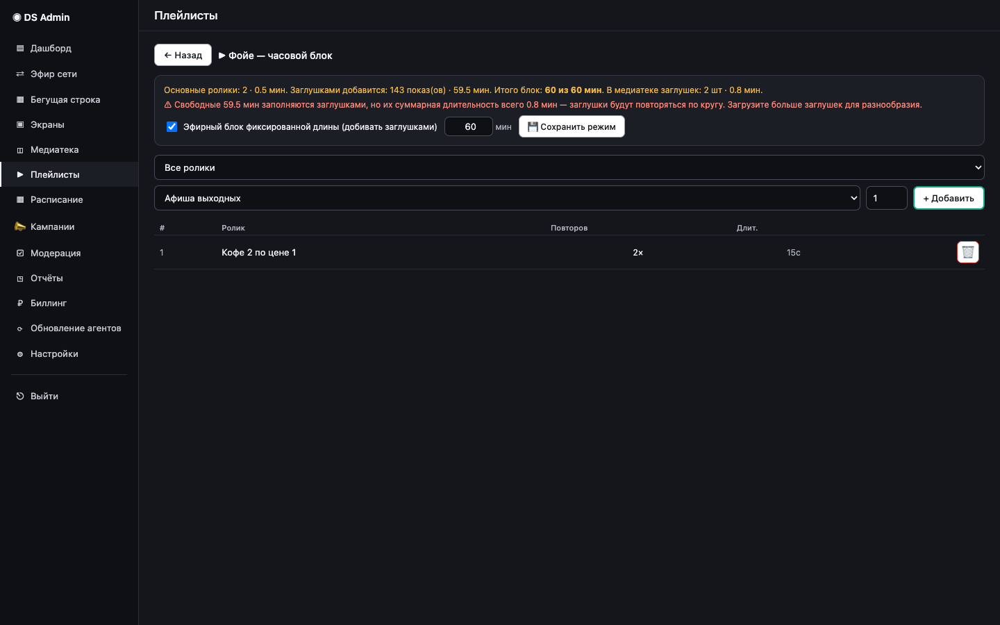

По умолчанию плейлист — **эфирный блок фиксированной длины 60 минут**
(это максимум — блок никогда не превышает цель). Если основные ролики короче,
свободное время **равномерно** заполняется заглушками между основными
роликами. Панель показывает расчёт (основные · заглушками добавится · итого)
и **предупреждает**, если: основные ролики длиннее цели; заглушек нет; их
суммарного времени не хватает (будут повторяться по кругу).

Галочка «Эфирный блок фиксированной длины» снимается — плейлист становится
**произвольным** (играет как есть). Целевая длительность меняется там же
(1–1440 мин). Повторы ×N входят в расчёт блока: ролик ×3 занимает в блоке
утроенное время.

---

## Расписание

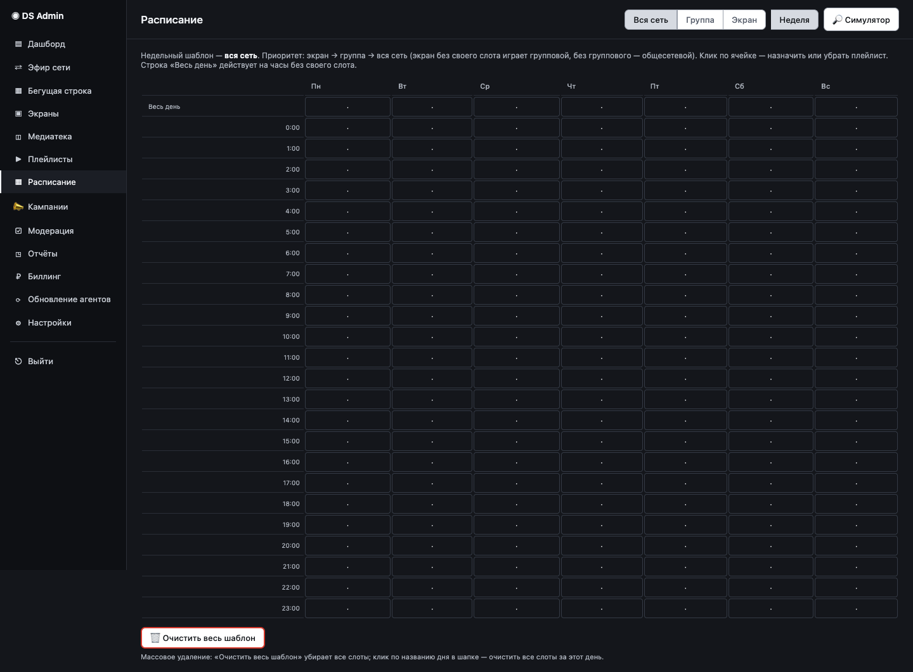

Недельный шаблон (сетка «день × час», время МСК) на трёх уровнях:
- **Экран** — конкретному экрану;
- **Группа** — всем экранам группы;
- **Сеть** — всей сети.
Более узкий уровень переопределяет более широкий (экран > группа > сеть).
Поверх шаблона — **переопределения на конкретные даты** (календарь месяца);
«Сбросить переопределения месяца» возвращает шаблон.

Режимы просмотра (переключатель справа вверху): **«Неделя»** — шаблон,
**«По датам»** (только для цели «Экран») и **«Даты»** — календарь месяца для
переопределений.

### Режим «По датам»
Показывает, что **реально** играет на выбранном экране: настоящая неделя с
числами (МСК), строки — часы 0–23. Листание — **‹ ›** (предыдущая и следующая
неделя) и **«Сегодня»**. Клетка окрашена по источнику:
- *обычный недельный шаблон*;
- **📅 отправленный показ** (из «Куда и когда») — идёт поверх шаблона;
- **⇄ по очереди** — в этот час идут вперемешку плейлисты нескольких показов;
- *плейлист на дату* (датовое переопределение);
- *выключено на дату*;
- *ничего не играет*.

**Клик по клетке показа** (📅 или ⇄) открывает под сеткой **карточку показа**:
плейлист и экран, даты и часы, на каких экранах идёт, статус, кто и когда
отправил; если на этом экране показ на часть периода уступил другому плейлисту
(«Оставить „…“ на это время»), — строки «уступает „…“». В уступленные часы в
клетке стоит тот плейлист, который в них реально идёт. Кнопки: **«Открыть
плейлист»**, **«Изменить»**, **«Остановить»** (идёт) или **«Отменить»**
(запланирован), **«Повторить»** (закончился или остановлен); ✕ закрывает
карточку. Изменения сразу видны в сетке. Режимы «Неделя» и «Даты» работают как
раньше.

Инструменты:
- **⧉ Скопировать расписание экрана…** — перенести шаблон на другой экран;
- массовое удаление: **«Очистить весь шаблон»**, клик по названию дня — очистить
  день, галочки — удалить выбранные слоты;
- **🔎 Симулятор** — что реально будет играть на экране в выбранный час
  (с учётом всех уровней, дат, **отправленных показов**, модерации и типа
  площадки); подсвечивает источник: сеть / фолбэк / пусто.

Приоритет источников на экране, сверху вниз: **«Эфир сети»** → датовое
переопределение «выкл» → **показ по датам** (с учётом решений «заменить» / «по
очереди» / «оставить „…“») → датовое переопределение с плейлистом → недельный
шаблон (экран > группа > сеть) → заглушки.

---

## Эфир сети

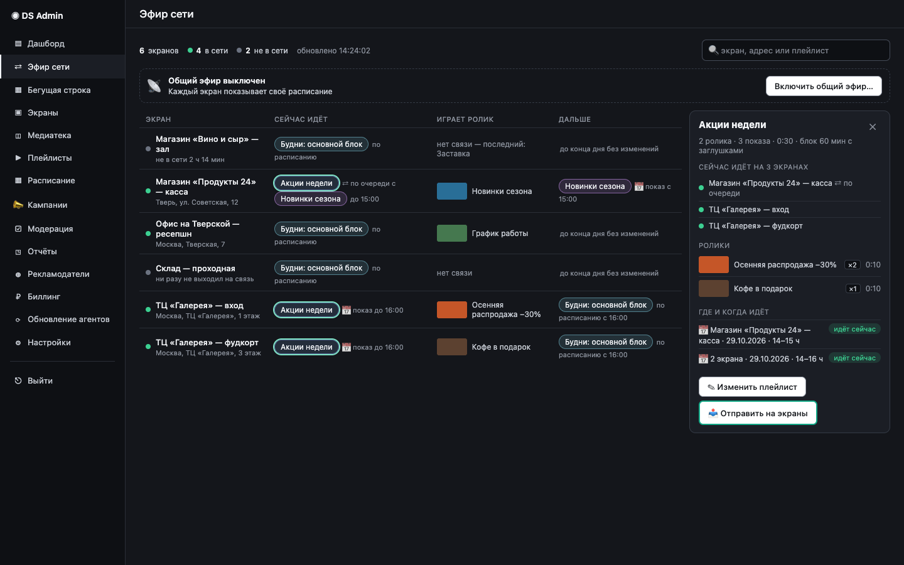

Общий эфир: один плейлист на **всю сеть** одновременно (общесетевые объявления,
акции). Пока включён — перебивает индивидуальные расписания; «Снять общее» —
вернуть каждому экрану своё.

---

## Бегущая строка

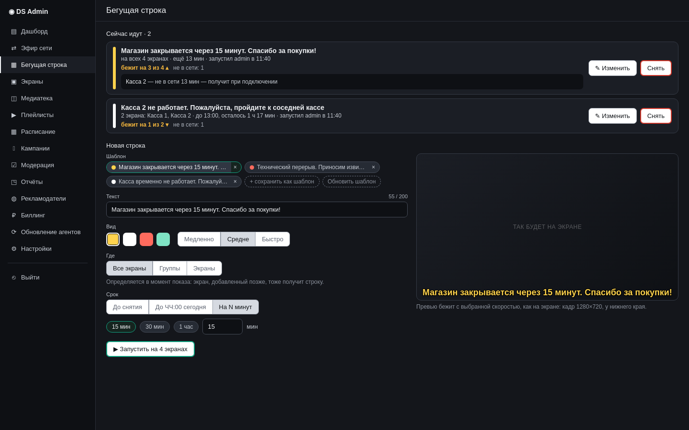

Текстовый тикер поверх видео: **текст, цвет, скорость, время показа** (0 или
пусто — бессрочно, до снятия). «Запустить бегущую строку» / «Снять». Строка
рисуется плеером mpv на всех экранах.

> Строка живёт, пока идёт показ, при котором её запустили: при команде
> **«Стоп»** или **смене плейлиста** (кончился слот, включили другой
> плейлист/эфир) задание снимается **автоматически** и фиксируется в журнале.
> Для нового показа строку запускают заново.

---

## Кампании

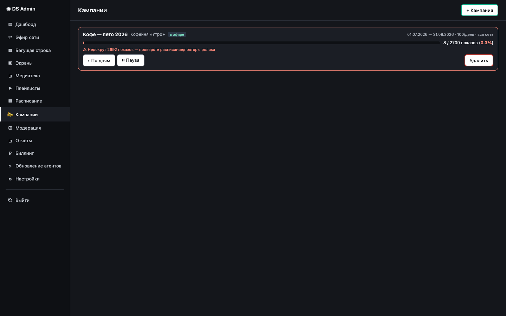

Рекламная кампания = рекламодатель + период + **план показов в день**.
Панель считает **план/факт** (по журналу показов), развёртку «по дням», охват
экранов; KPI и «истекающие KPI» видны в отчётах. Кампанию можно поставить на
**паузу** и возобновить.

---

## Модерация

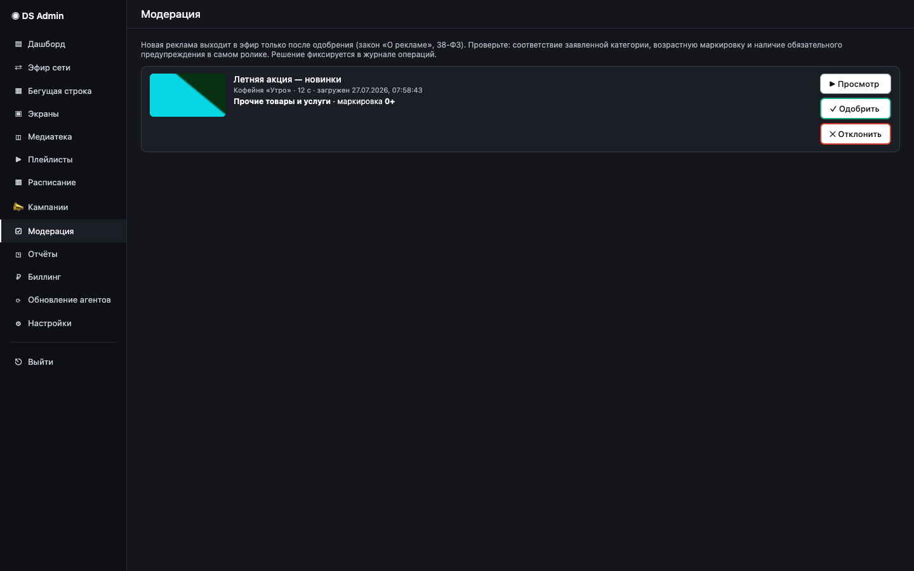

Проверка рекламы по 38-ФЗ: `pending → approved/rejected`. Обычно этим занимается
[модератор](05_РОЛЬ_МОДЕРАТОР.md), но у администратора то же право. «Просмотр» —
посмотреть сам ролик; при отклонении указывается причина. Каждое решение
фиксируется в журнале операций. В эфир идут **только одобренные** ролики.

---

## Отчёты

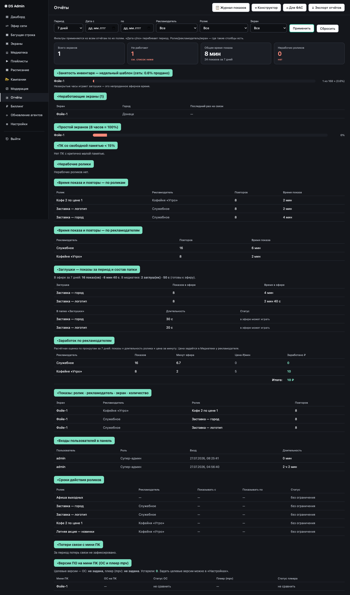

Сверху — **единая панель фильтров** (период/даты, рекламодатель, ролик, экран,
**день недели**), применяется ко всем отчётам по показам. Все метки времени в
панели показываются с днём недели («пн, 27.07.2026, 13:00»). Дополнительно у **каждой таблицы** — свой
строковый фильтр («🔍 Фильтр по этой таблице…») и **сортировка кликом по
заголовку столбца** (повторный клик меняет направление). Секции сворачиваются
кликом по заголовку:

- **Занятость инвентаря** — сколько часов недельного шаблона продано, по экранам;
- **Неработающие экраны**, **Простой экранов**, **ПК со свободной памятью <15%**;
- **Нерабочие ролики** (ошибки воспроизведения);
- **Время показа и повторы** — по роликам и по рекламодателям;
- **Заглушки** — показы заставок за период (всего и по каждой) + состав папки;
- **Заработок по рекламодателям** (показы × длительность × ₽/мин);
- **Показы: ролик · рекламодатель · экран**;
- **Входы пользователей в панель**, **Сроки действия роликов**,
  **Потери связи с мини-ПК**, **Версии ПО на мини-ПК** (ОС и mpv).

Кнопки сверху: **📋 Журнал показов** (сырой лог: дата, **день недели**, время,
экран, ролик, рекламодатель — с теми же фильтрами, включая день недели;
столбец «День» попадает и в выгрузки Excel/PDF),
**⚒ Конструктор** (собрать свой отчёт и сохранить его),
**⚖ Для ФАС** (выгрузка для контролирующих органов: декларации, решения
модерации, показы), **↓ Экспорт отчётов**.

---

## Биллинг

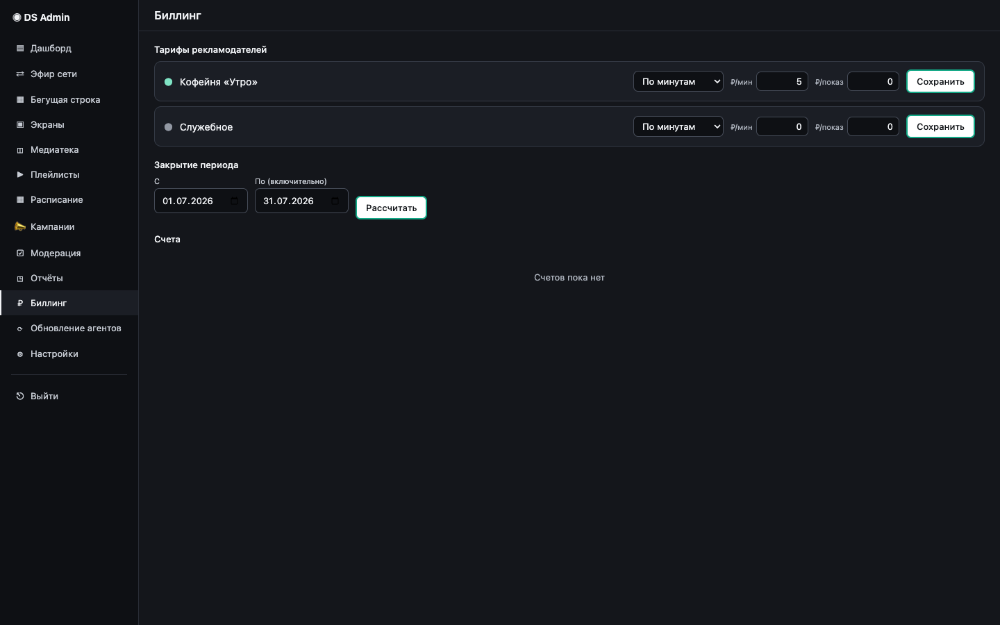

Счета рекламодателям по фактическим показам:
- **способ расчёта** — «цена за минуту эфира» или «цена за один показ»;
- «Рассчитать» за период → «Выставить счёт»;
- **▸ Ролики** — детализация счёта по каждому ролику;
- **Скидка/доплата** с примечанием (например, за простой экранов);
- «Скачать PDF», отметка **«Оплачен»** / «Вернуть», удаление.

---

## Обновление агентов (OTA)

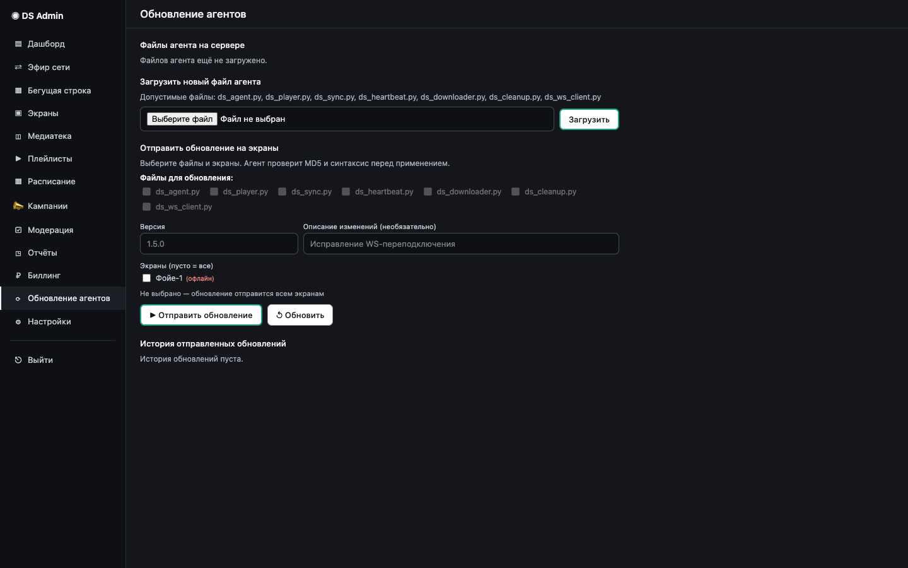

Централизованный раскат новой версии агента на мини-ПК: загрузить изменённые
`.py`-модули (панель покажет размер и MD5), указать версию и changelog, выбрать
экраны галочками → «Отправить». Агент проверяет контрольные суммы и синтаксис,
делает резервную копию и при любой ошибке **откатывается сам**. Подробно —
[07_ОБНОВЛЕНИЕ_АГЕНТА](07_ОБНОВЛЕНИЕ_АГЕНТА.md). Раскатывайте поэтапно:
сначала 1–2 пилотных экрана.

---

## Настройки

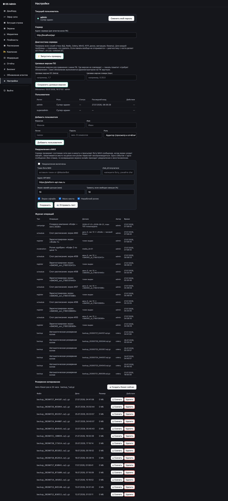

- **Текущий пользователь** — сменить свой пароль.
- **Сервер** — адрес API для агентов мини-ПК.
- **Диагностика сервера** — «Запустить проверку»: БД, миграции, Redis, Celery,
  MinIO, NTP, диски, свежесть бэкапа, экраны и ролики — каждый пункт со
  статусом и подсказкой «что сделать». Если панель вообще не открывается —
  диагностику с хоста делает `selfheal.sh`
  (см. [runbook §0](../Техдокументация/03_RUNBOOK_ИНЦИДЕНТЫ.md)).

  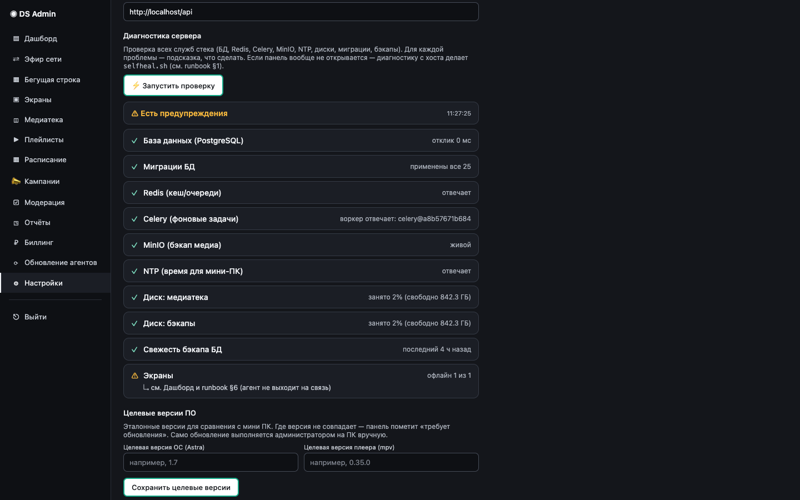

- **Целевые версии ПО** — эталонные версии ОС (Astra) и плеера (mpv): где не
  совпадает, панель пометит «требует обновления» (отчёт «Версии ПО»).
- **Пользователи** (только `superadmin`): создать (логин, пароль, имя, роль
  *Админ / Аудитор / Модератор / Рекламодатель*), редактирование,
  блокировка/разблокировка, смена пароля, удаление.
  При выборе роли **«Рекламодатель»** появляется поле **«Наименование
  рекламодателя»** — под этим именем сразу заводится кабинет, и оно же пойдёт
  в акт и эфирную справку. Если рекламодатель с таким наименованием уже есть в
  медиатеке, учётка привяжется к нему (дубль не создаётся). Оставите поле
  пустым — возьмём фамилию и имя из учётной записи.
  Удаление такого пользователя **не удаляет кабинет**: в нём ролики, счета и
  документы. Кабинет удаляется отдельно, в Медиатеке.
- **Уведомления (MAX)**: токен бота, адрес, порог офлайна, выбор событий,
  тест. Подробно — [01, §6](01_УСТАНОВКА_СЕРВЕР.md#6-настройка-max-уведомлений-необязательно).
- **Журнал операций** — полный аудит: кто, когда и что сделал.
- **Резервное копирование** — автобэкап БД (раз в 24 ч) и медиа (MinIO);
  «Создать бэкап сейчас». Восстановление — [RESTORE_GUIDE](../RESTORE_GUIDE.md).

---

## Типовой полный цикл

1. Завести экраны, раздать токены, поставить агенты ([02](02_УСТАНОВКА_АГЕНТ.md)).
2. Задать типы площадок и группы экранов; настроить питание/громкость.
3. Загрузить заглушки (Медиатека → Заглушки) — они добивают эфирные блоки.
4. Загрузить ролики с декларацией категорий (38-ФЗ) → модерация.
5. Собрать плейлисты («+ Плейлист»: поиск, галочки, повторы ×N; обычно «блок
   60 мин»). Отправить на экраны кнопкой «Создать и отправить →»: экраны, даты,
   часы, решения по пересечениям. Постоянную сетку недели — по-прежнему в
   Расписании (экран/группа/сеть). Проверить: «Где и когда идёт» в карточке
   плейлиста, Расписание → «По датам», симулятор.
6. Завести кампании с планом; следить за план/фактом.
7. Следить за Дашбордом и уведомлениями; снимать отчёты и счета.
8. Регулярно: Настройки → «Запустить проверку» и контроль бэкапов.

Ежедневная рутина сжато — в [руководстве оператора](06_РОЛЬ_ОПЕРАТОР.md).
Отказы и лечение — в [runbook](../Техдокументация/03_RUNBOOK_ИНЦИДЕНТЫ.md).
